# NullOps - Web Resource Manager (`nullops`)

A stand-alone, **encrypted** web resource manager in a single executable. The web
interface (HTML/JS/CSS) is embedded in the binary in obfuscated form and served
straight from memory: download one file (`nullops.exe`, for example) and run it.

```bash
nullops web -r /data -b 0.0.0.0 -p 8443
```

- **Single binary**: front-end embedded (zip + AES-256-GCM), never extracted to disk.
- **Encrypted `/api` channel**: ECDH P-256 → HKDF-SHA256 → AES-256-GCM, one key per session.
- **Persistent sessions**: valid for 12 hours after login, surviving page reloads and server restarts.
- **HTTPS by default**, with a self-signed certificate generated on the first run.
- **Pure Go server** (`net/http`).

> The original Python implementation lives in the `python` branch.

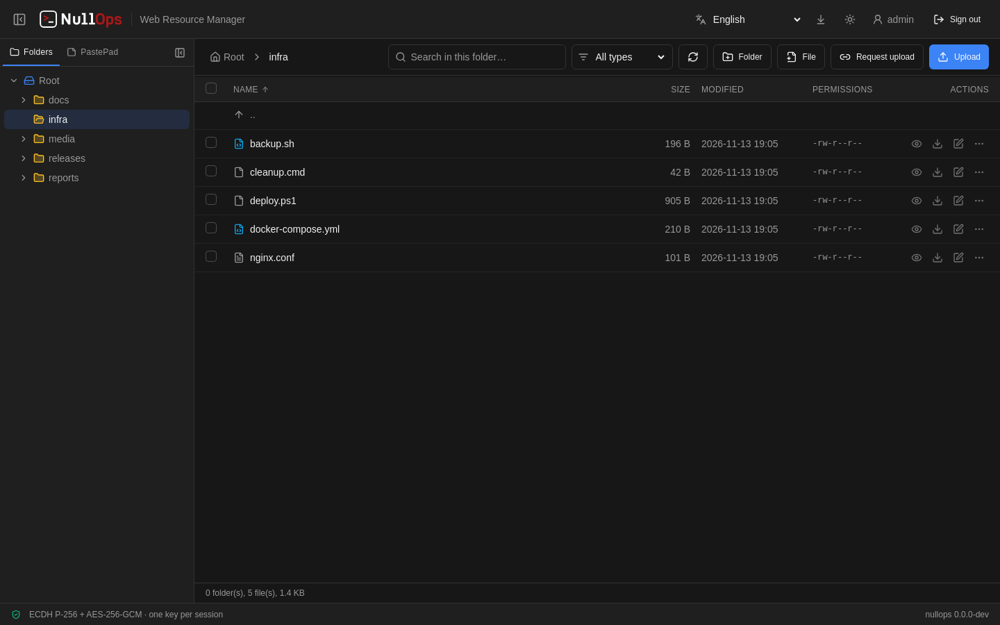

## Screenshots

**Sign in** — in steps: user, then the authenticator code (only for users with MFA), then the password.

| Sign in | MFA code |
| --- | --- |
| 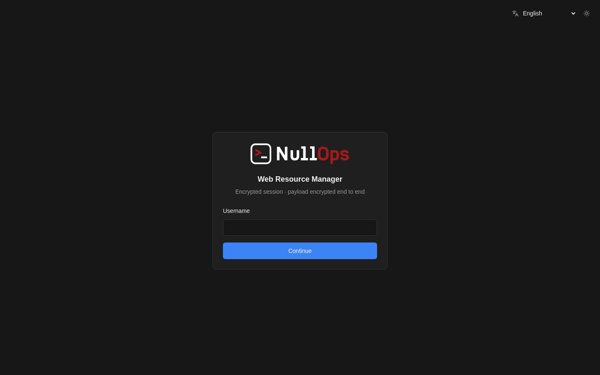 | 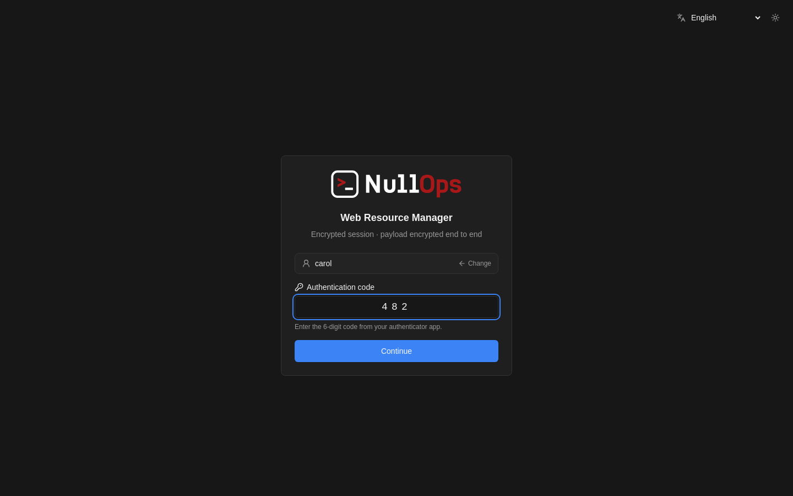 |

**Managing files** — every row has quick actions (preview, download, edit) and a menu with rename, copy, move,
permissions and delete. Copy and move use a folder picker; files can also be dragged onto a folder.

| Actions menu | Move to another folder |
| --- | --- |
| 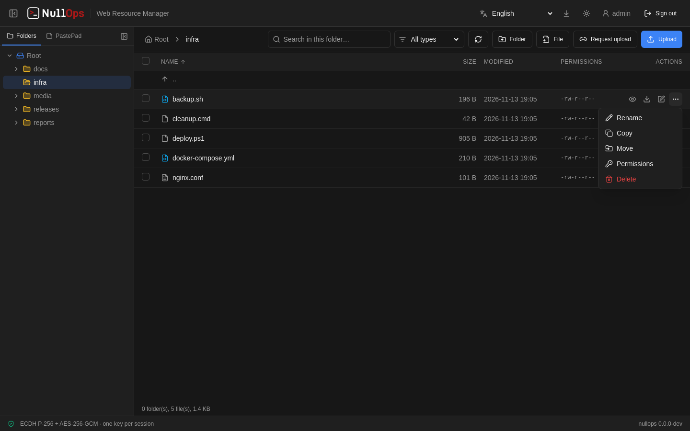 | 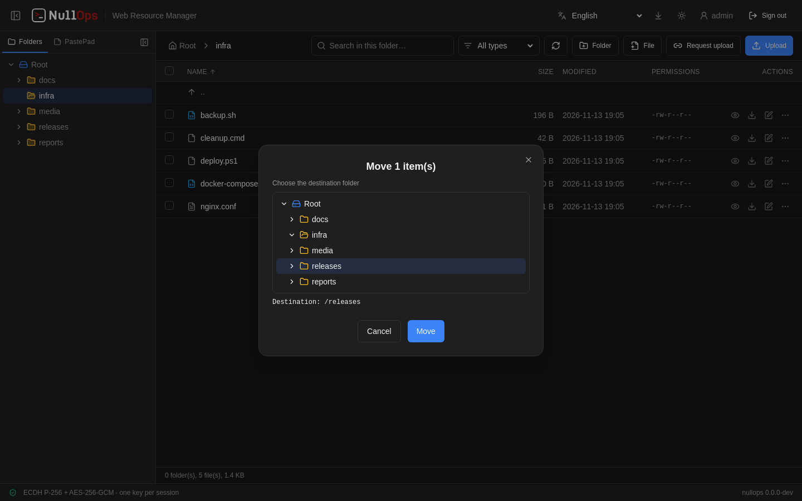 |

**Editing and previewing** — text files open in the editor with syntax highlighting (here a PowerShell script);
images, SVG and PDF open in the viewer, with previous / next inside the folder.

| Editor | Preview |
| --- | --- |
| 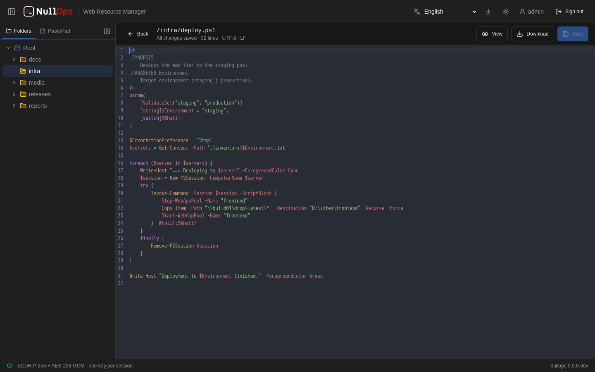 | 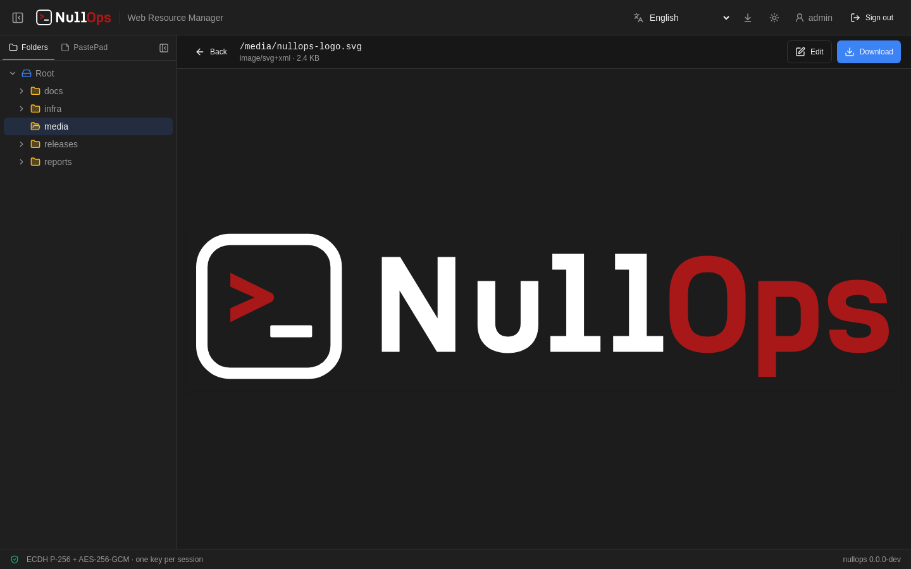 |

**Encrypted payload** — every `/api` request and response travels inside an AES-256-GCM envelope (`iv` +
`data`), on top of HTTPS. Below, the real traffic captured while opening a folder (the screenshot script records
it and draws it in an inspector-style panel).

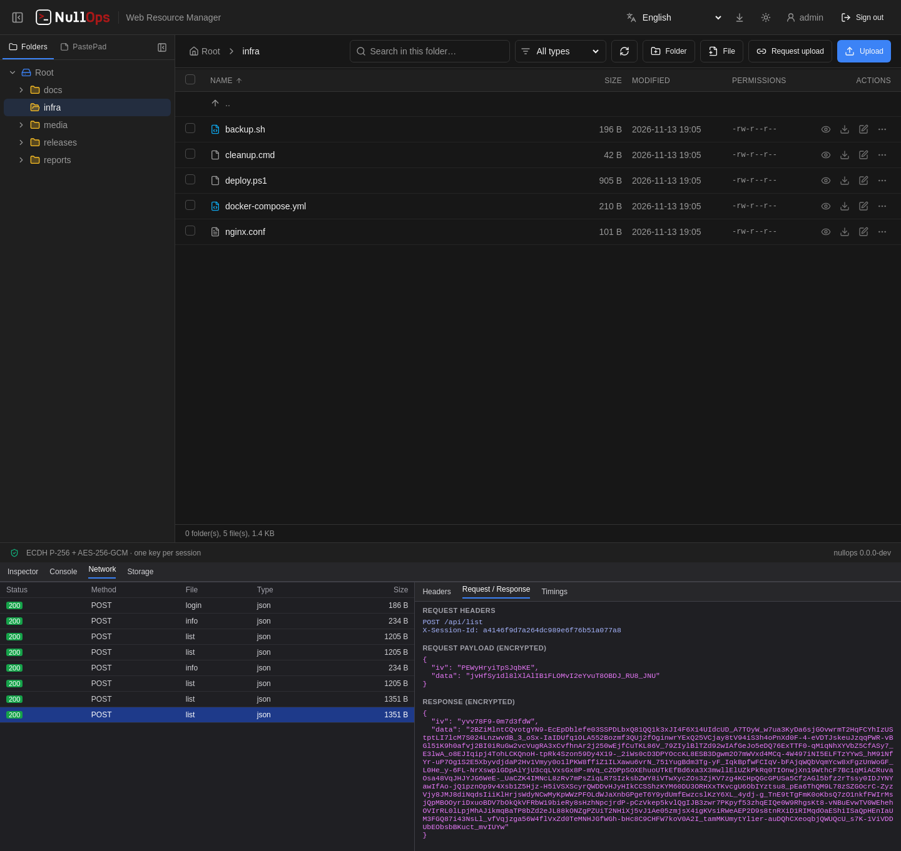

**Upload links and transfers** — *Request upload* creates a public link for a folder; whoever has it can send
files without an account (they are saved as `name-<epoch>.ext`). Your own downloads and uploads show their overall
progress in the header and on the Transfers page.

| Upload link | Public upload page |
| --- | --- |
| 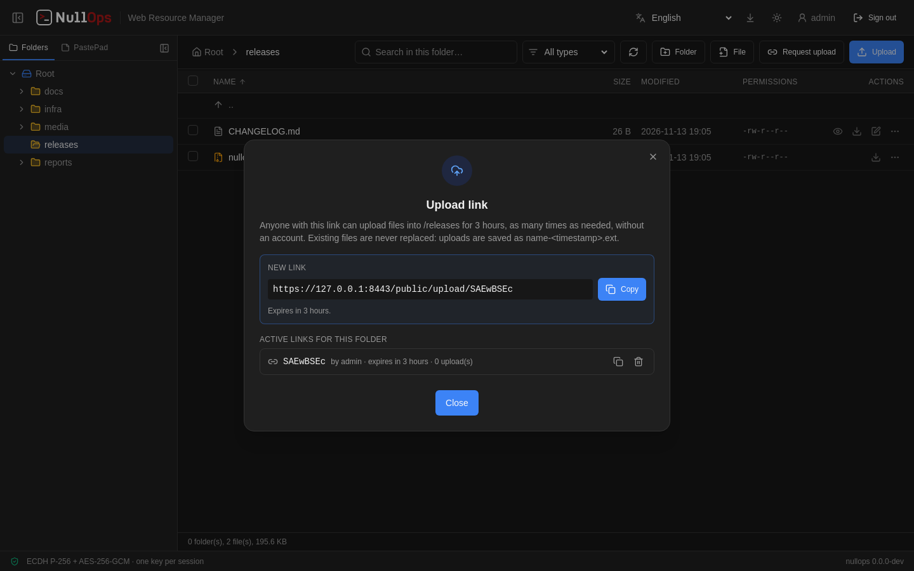 | 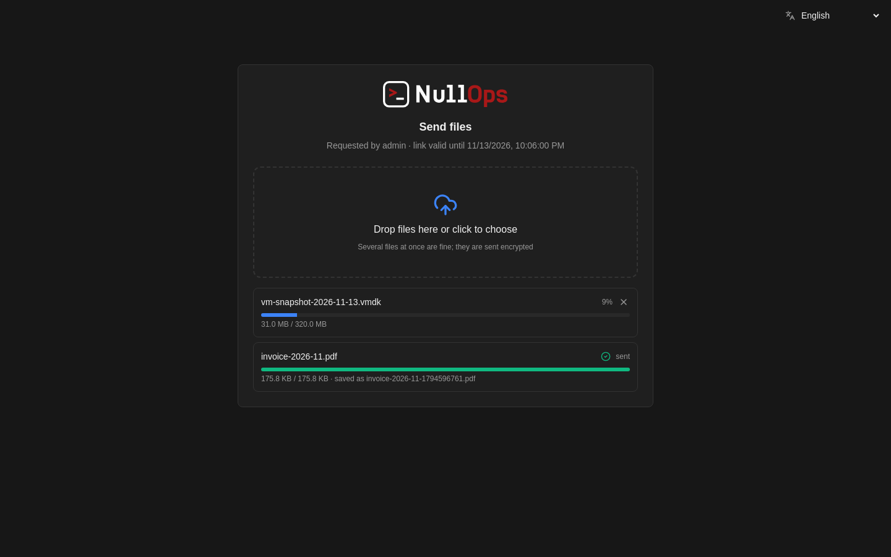 |

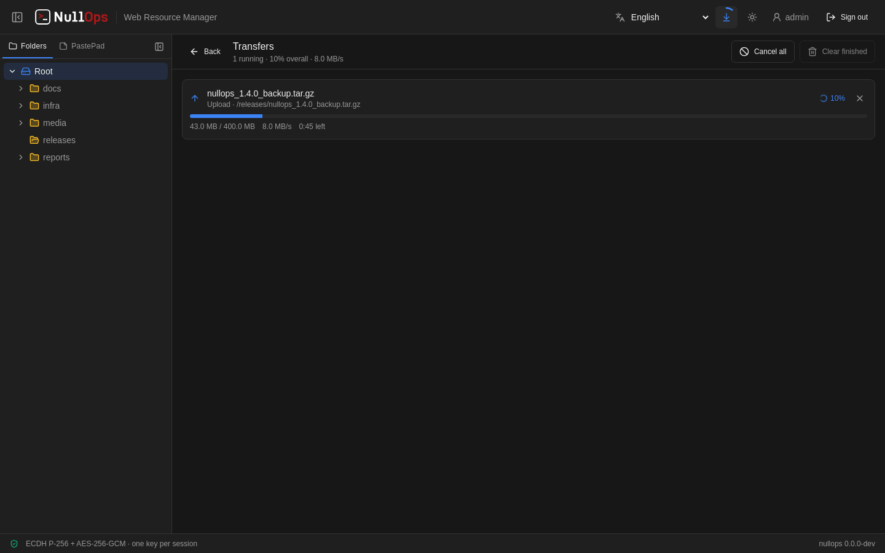

**PastePad** — shared text pads edited by several users at the same time (here `admin` and `ana`).

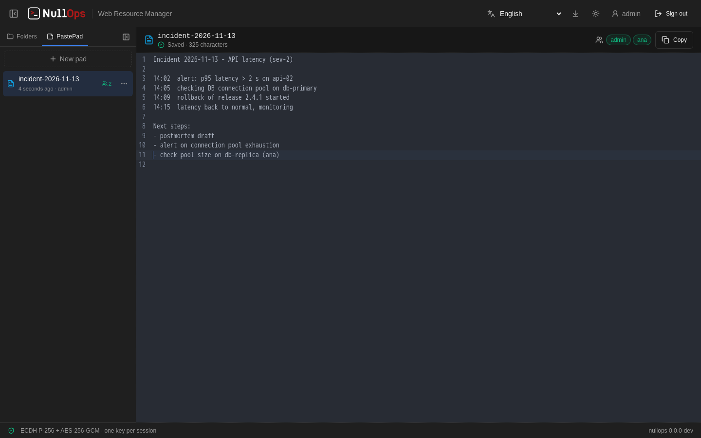

**Account security and light theme** — each user can turn on TOTP MFA by scanning a QR code; the interface
has dark and light themes and English / Portuguese.

| Enable MFA | Light theme |
| --- | --- |
| 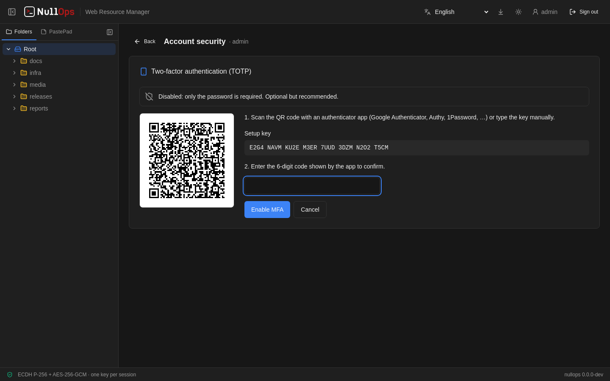 | 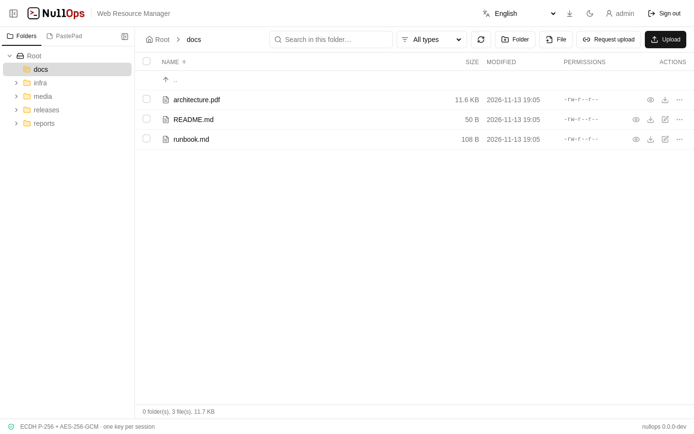 |

The screenshots are generated with demo data by `make screenshots` (Docker + Playwright, see
`tools/screenshots/`).

## Subcommands

| Command | What it does |
| --- | --- |
| `nullops create-tls` | Creates a self-signed certificate (`--host`, `--days`, `--force`), imports one (`--cert`, `--key`) or gets one from Let's Encrypt (`--acme --domain files.example.com [--acme-email] [--acme-staging]`) |
| `nullops add-user`   | Adds or updates a user (`-u`, `-p` / prompt / `--generate`, `--readonly`, `--update`, `--set-password`, `--mfa` / `--no-mfa`) |
| `nullops mfa-qr`   | Shows a user's MFA QR code in the terminal (ASCII), with the setup key, to enroll a new authenticator app |
| `nullops list-users` | Lists users (access, MFA, dates) |
| `nullops del-user`   | Deletes a user and revokes its sessions |
| `nullops sessions`   | Lists active sessions; `sessions revoke <id-prefix> \| --user <name> \| --all` |
| `nullops web`        | Starts the server (`-r` root, `-b` bind, `-p` port, `--readonly`, `--show-hidden`, `--exclude`, `--allow-ext`, `--max-upload`, `--audit-log`, `--trusted-proxy`, `--session-ttl`, `--no-tls`, `-y`, `--no-auth`) |
| `nullops version`    | Version and build information |

Changes to users (`add-user`, `del-user`) and revoked sessions take effect on a running server within seconds.

### Sign-in and MFA

Sign-in happens in steps, over the encrypted channel: **user → [MFA code] → password**.

- MFA (TOTP, any authenticator app) is **optional**. A user enables it in the web UI (user menu → *Account
  security*: scan the QR code, confirm with a code) or the admin runs `nullops add-user -u bob --update --mfa`,
  which prints the QR code in the terminal. Disabling it in the UI requires a current code.
- An unknown username always gets the MFA step, as if it existed with MFA, and the attempt is logged
  (`login attempt with unknown user`). Its code is always rejected.
- A real user without MFA goes straight to the password, so the "MFA" answer is the only ambiguous one: to hide
  which accounts exist completely, enable MFA for everyone.
- Five failures (code or password) from the same IP lock it out for five minutes; a code cannot be reused.

Global flags: `--data-dir` (default `~/.nullops`), `-v`/`-vv` verbosity, `-D` (= `-vv`), `-q` quiet.

| Level | Flag | What is shown |
| --- | --- | --- |
| quiet | `-q` | errors only |
| info | *(default)* | page access, login/logout, file operations |
| debug | `-v` | plus TLS/HTTP server errors (e.g. `tls: bad certificate` from a browser that does not trust the self-signed certificate yet) and read calls (`list`, `search`, `info`) |
| trace | `-vv` / `-D` | plus every HTTP request (method, path, status, bytes, ms) and the source location of each line |

### `--no-tls`: no payload encryption

Without TLS the browser only exposes WebCrypto on `localhost`, so `--no-tls`
also **disables the payload encryption** of `/api`. That encryption is what
keeps proxies, IDS/IPS and EDR/DLP agents from identifying the traffic: with it
off, logins, passwords, file names and contents travel in clear text.

The console shows this warning and asks `Do you want to continue? [y/N]`
(the default is no). Without a terminal the server refuses to start unless
`-y/--yes` is passed. The UI shows a red banner on the login screen and in the
footer. A server running with TLS refuses unencrypted clients, so a client
cannot downgrade the session to clear text.

### PastePad

The side panel has two tabs: **Folders** and **PastePad**. PastePad keeps shared
plain-text pads, like dontpad: create one with a name made of letters, digits,
`.`, `-` and `_`, and every signed-in user can open it at `/pad/<name>` and edit
it at the same time, from any computer.

- **Sync**: long polling over the same encrypted `/api` channel (no separate
  WebSocket channel to secure). The server answers as soon as anyone changes the
  pad, so updates show up immediately.
- **Merging**: Operational Transformation. Each edit is sent as an operation
  based on the revision the browser knew; the server transforms it against the
  edits that arrived in the meantime, so simultaneous edits (even at the same
  spot) are all kept, never overwritten.
- **Storage**: every 5 seconds and on shutdown, each pad is written to
  `~/.nullops/pads/<uuid>`, encrypted with AES-256-GCM; its 256-bit key is in
  `~/.nullops/nullops.db`. Up to 1 Mi characters per pad.

### Folder panel

The *Folders* tab of the side panel shows the folder hierarchy and expands itself to the
folder being browsed. Drag its right edge to resize it (double-click resets the
width). Hide or show it with the button at the top left of the header. The
width and open/closed state are remembered per browser.

### Upload links (Request upload)

The **Request upload** button of a folder creates a public link,
`/public/upload/<token>` (8 characters, `[A-Za-z0-9]`), that lets anyone send
files into that folder **without an account**, for **3 hours**, as many times as
needed. The page accepts several files at once and drag and drop, and the files
still travel over the encrypted channel.

- Uploaded files never replace anything: they are saved as `name-<epoch>.ext`
  (`-<epoch>-1`, `-2`… if two arrive in the same second).
- File names are sanitized (path parts, control/bidi/zero-width characters,
  Windows-reserved characters and names, leading dots, length).
- The request (folder, who asked, expiry, uploads) is stored in
  `~/.nullops/nullops.db`; active links can be copied or revoked in the same
  dialog. Guessing tokens counts towards the per-IP lockout, and every use is
  in the audit log.
- `--max-upload` and `--allow-ext` apply; read-only users cannot create links.

### Transfers

Downloads and uploads run in the background while you keep browsing. The
download icon in the header shows a ring with the overall progress, and clicking
it opens the **Transfers** page (progress, speed, time left, cancel). Reloading or
closing the page with transfers running asks first.

Folders and selections download as a zip built on the fly. On Chrome and Edge,
files of 256 MB or more are written straight to disk while they download (the
browser asks where to save first).

### Opening a file

Clicking a file asks the server to sniff the **MIME type of its first 4096
bytes** (WHATWG sniffing from `net/http`, then a UTF-8 / binary-byte check over
the whole buffer). `text/*` opens in the viewer/editor (read-only accounts get
the viewer); anything else is downloaded. The extension list is only used as a
fallback if the probe fails. UTF-16 text is recognized but downloaded, since
the editor works in UTF-8.

### Console log

| Event | Fields |
| --- | --- |
| `access` (GET of `/` and SPA routes) | `ip`, `path`, `ua` |
| `login` / `login failed` / `login blocked` / `logout` | `user`, `ip`, `ua` (login) |
| `upload`, `download`, `open`, `edit`, `create`, `mkdir`, `rename`, `delete`, `copy`, `move`, `chmod`, `zip`, `tar`, `extract` | `user`, `ip`, `path(s)`, plus `size` / `dest` / `mode` depending on the action |

Failures are logged as `WARN … failed` with `err`. Listing and search only show up with `-v`.
Console lines carry a timestamp; `--audit-log FILE` also appends every audit event as a JSON line
(`time`, `level`, `event`, `user`, `ip`, …). Behind a reverse proxy, pass `--trusted-proxy 10.0.0.0/8` so the
real client IP from `X-Forwarded-For` is logged (only trusted hops are skipped, so it cannot be spoofed).

### Sessions

After login the session is valid for **12 hours** (`--session-ttl`, in
seconds), across page reloads, new tabs and server restarts. Signing out ends
it immediately.

- **Server**: `~/.nullops/nullops.db` (SQLite, 0600). The session id is never
  stored; rows are keyed by SHA-256(id), and the AES key is wrapped with
  AES-256-GCM under a key derived from the id. A copy of the database alone
  does not reveal session keys or allow reusing a session.
- **Browser**: the id and the AES key, stored as a **non-extractable**
  `CryptoKey` in IndexedDB, so scripts cannot read the key bytes.
- Handshakes not followed by a login stay in memory only and expire after
  10 minutes. Expired rows are purged automatically.
- On every request the account is re-checked: a removed user loses the
  session, and changing the read-only flag takes effect.
- A session created with TLS is not accepted by a `--no-tls` server, and the
  other way around.

### User data (`~/.nullops`)

```
~/.nullops/            # %USERPROFILE%\.nullops on Windows
├── tls/cert.pem    # certificate
├── tls/key.pem     # private key (0600)
├── users.json      # users (scrypt hashes, 0600)
├── nullops.db      # SQLite (0600): active sessions + PastePad metadata and keys
└── pads/<uuid>      # PastePad contents, AES-256-GCM encrypted (0600)
```

On first run with no users, `web` creates `admin` with a random password and
prints it **only once**. The scrypt format is the same as the Python version's.

## Build

Requirements: Go 1.24+ and Docker (the front-end is built in a container; the
host does not need Node). With Node installed, use `FRONTEND_BUILDER=local`.

```bash
make                  # front-end → obfuscated bundle → binary for the local platform
make all              # cross-compile: windows/linux/darwin × amd64/386/arm64
make OBFUSCATE_JS=0   # skip the JavaScript obfuscation (on by default; faster, easier to debug)
make test             # Go tests (requires `make assets` once)
make test-frontend    # front-end unit tests (vitest)
make screenshots      # regenerate the README screenshots (Docker + Playwright)
make clean
```

Pipeline:

1. `make frontend`: `docker build` of `frontend/` (Vite + React + Tailwind) → `frontend/dist/`
2. `make assets`: `tools/assetpack` seals `dist/` into `pkg/assets/bundle.bin` under a random per-build key
   (`build/.pepper`, also injected into the binary with `-ldflags`)
3. `go build`: `//go:embed bundle.bin`; at runtime the bundle is decrypted into RAM

CI and releases run on GitHub Actions (`.github/workflows`): a published release builds every platform and
attaches the binaries and `SHA256SUMS`.

Binaries go to `./build/nullops_<os>_<arch>[.exe]`. `VER=1.2.3 make all` sets the version.

### Front-end development

```bash
nullops web --no-tls -y -p 8181       # API on http://127.0.0.1:8181 (no encryption)
cd frontend && npm install && npm run dev   # Vite with a proxy to /api
```

## Layout

```
main.go
cmd/                 # cobra: root, web, create-tls, add-user, version
internal/            # ascii (logo), version
pkg/
  api/               # dispatcher of the (decrypted) actions
  assets/            # embed + in-memory serving of the front-end
  assets/bundle/     # obfuscated bundle format (pack/open)
  auth/              # scrypt + users.json
  crypto/            # ECDH/HKDF/AES-GCM, envelopes and download frames
  datadir/           # ~/.nullops
  fileops/           # root-confined filesystem operations
  server/            # net/http, /api routes, login rate limit
  session/           # sessions: memory + SQLite (wrapped keys)
  tlsutil/           # certificate generation and import
tools/assetpack/     # build step: dist/ → bundle.bin
frontend/            # React 19 + Tailwind (pure JS), Vite, Dockerfile
```

Requirements, what is implemented and the roadmap are in [TODO.md](TODO.md).

## License

GPL-3.0 © Helvio Junior (M4v3r1ck)
